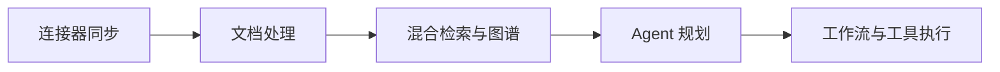

# 企业知识自动化与 Agent 工作流 · 工程导读

面向分散在多个平台的企业文档，将连接器接入、内容处理、检索问答和任务执行组织到同一平台。

## 先理解核心流程



## 值得深入的设计

- 将知识同步、检索与任务执行拆成独立模块，阅读时可以逐段跟踪输入、状态和输出。
- 权限、租户边界和审计横切 API 与运行时，关注检索与工具调用是否都携带正确上下文。
- Compose、Kubernetes 与 Helm 提供不同部署入口；实际外部连接器和模型服务需要独立配置。

## 沿源码验证能力

1. **[连接器](../app/connector)**：沿此入口检查实际实现与调用关系。
2. **[同步引擎](../app/sync_engine)**：沿此入口检查实际实现与调用关系。
3. **[检索入口](../app/search)**：沿此入口检查实际实现与调用关系。
4. **[Agent 运行时](../app/agent_runtime)**：沿此入口检查实际实现与调用关系。
5. **[工作流](../app/workflow_engine)**：沿此入口检查实际实现与调用关系。
6. **[权限架构](../docs/ENTERPRISE_SECURITY_ARCHITECTURE.md)**：沿此入口检查实际实现与调用关系。

## 最短运行路线

以下为仓库既有脚本或配置对应的命令。命令以类 Unix Shell 为例，在仓库根目录执行；先准备所需服务和配置，不代表本次文档修改已经完成运行验证。

```bash
cp .env.example .env
# 编辑 .env，配置模型与本地环境
bash scripts/demo_start.sh
```

## 一次演示应验证什么

1. 脚本检查 Docker / Compose，等待 /api/health 后调用 Python seed 脚本；宿主机也需要 Python 及 seed 脚本依赖。
2. 先验证登录与知识查询，再执行一个只读 Agent 任务，核对检索引用和调用记录。
3. 工作流、连接器和图谱应按各自配置单独验证，首页列出模块并不等于已完成目标环境联调。

## 当前边界与复现条件

- 已有 README 中的 1060 passed 与稳定套件 998 passed 属于不同统计口径；本次文档优化未重新执行测试，不把这些数字作为本次验证结果。
- 演示配置、默认账号与生产配置应区分；部署要求以 SECURITY.md 和 Release Guide 为准。

## 继续贡献

建议从最小可复现场景开始：描述输入、预期输出、实际结果、运行版本和相关日志，再提交 Issue 或针对对应模块的 PR。测试与性能结果需注明实际执行环境；不要仅根据功能列表推断生产可用性。

[返回项目首页](../README.md)
